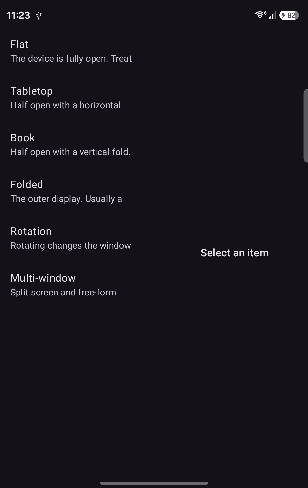
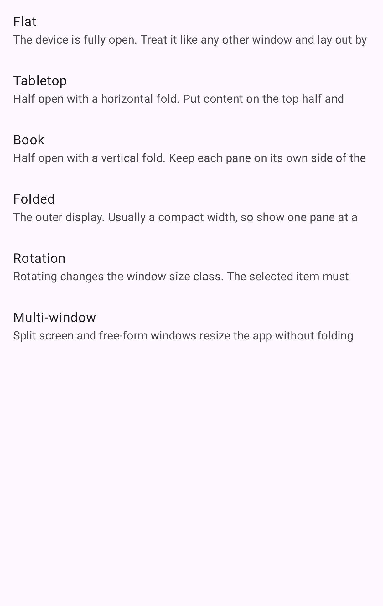
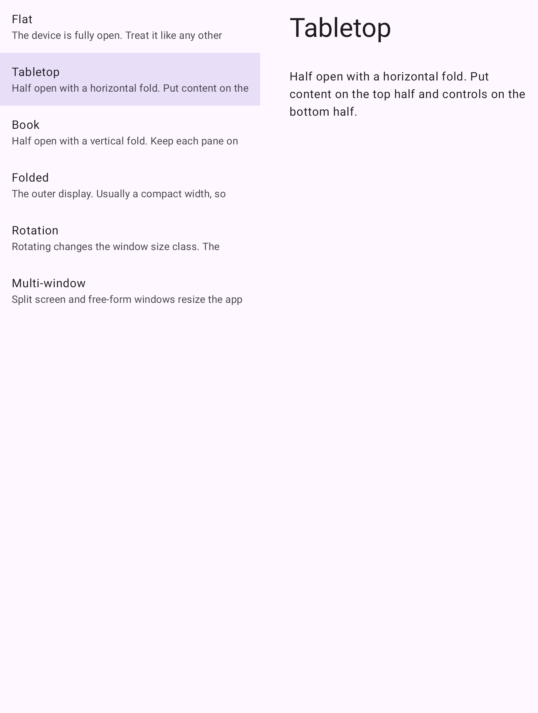
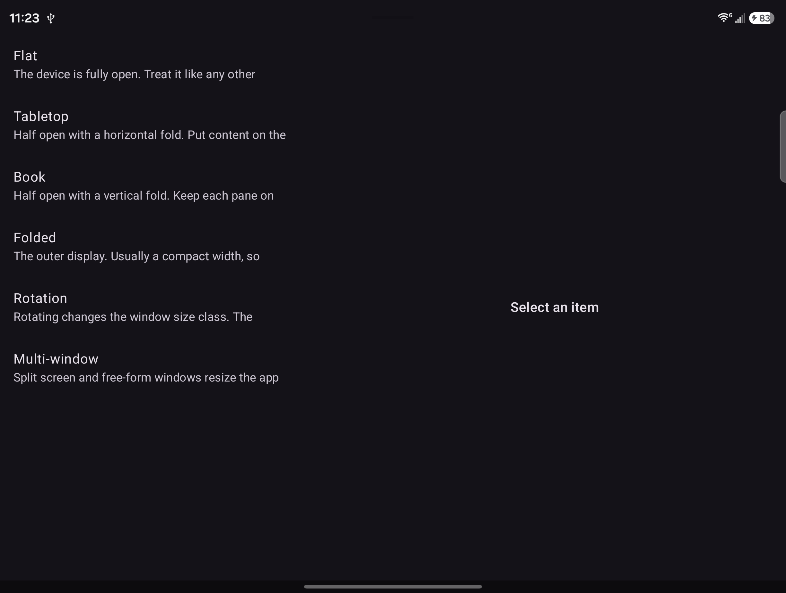
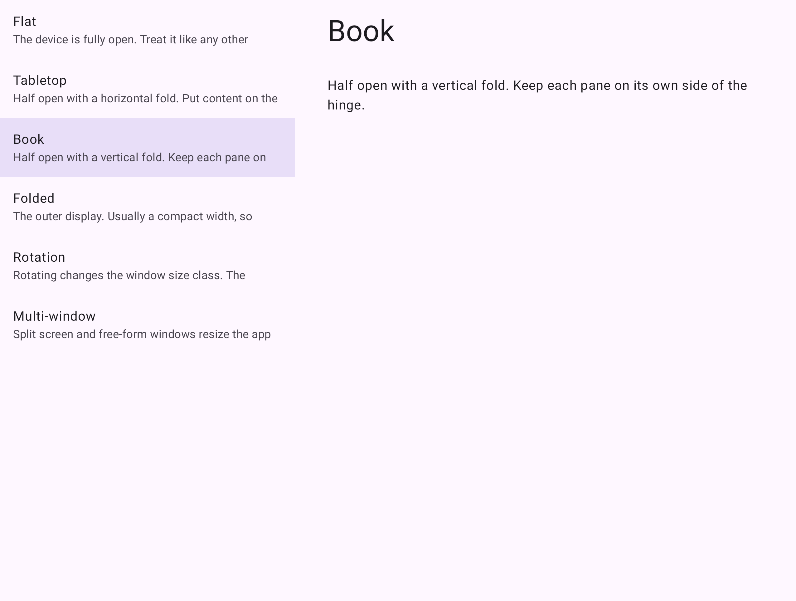

# Adaptwise Agent

Indie track. Build for Your World.

A Galaxy Z Fold 8 list-detail app was drawing two panes on the cover screen and a side-by-side layout in tabletop. The loop is a screenshot, a Muse Spark 1.3 diagnosis, a SAM 3.1 mask of the regions that diagnosis names, and the posture fix.

## Cover, on the phone

1248 × 1972. Muse Spark 1.3 said "Select an item" sits beside the list on a phone-width screen, and the fix is one pane until the user taps a row. SAM 3.1 then segmented those regions. The list box is about x 0–605, y 48–1321. The detail placeholder is about x 813–1086, y 1002–1039.

## Cover, after the fix

The fixed cover render is one column. Muse Spark reported no layout failure on it.

## Tabletop

Muse Spark said the detail is beside the list, and a horizontal fold should stack the panes.

## Flat, on the phone

2448 × 1848. Two panes, and no failure. That count is right for a wide screen.

## Book

Two panes, which is the right count. A still does not show the hinge gap. A fold near 45 degrees is outside Samsung Flex mode (about 75–115), and FoldingFeature does not report a hinge angle, so that pose stays fully open.

## What the models could not do

Noun-phrase prompts to SAM ("list item", "text", "letter") returned no boxes on this dark screen. A point on a bright pixel did. The working path is Muse Spark for the regions, then SAM box prompts for the masks.

## The fix

The broken screen always uses an unfolded landscape directive and drops the hinge gap. The fixed screen passes the real window info to `calculatePaneScaffoldDirective` and keeps the back stack with `rememberNavBackStack`.

- Broken: [`src/broken/ListDetailScreen.kt`](src/broken/ListDetailScreen.kt)
- Fixed: [`src/fixed/ListDetailScreen.kt`](src/fixed/ListDetailScreen.kt)

Diagnoses are in [`notes/summary.json`](notes/summary.json) and [`notes/muse-texts.json`](notes/muse-texts.json). Models were `muse-spark-1.3` and `sam-3.1` on the Meta Model API.
